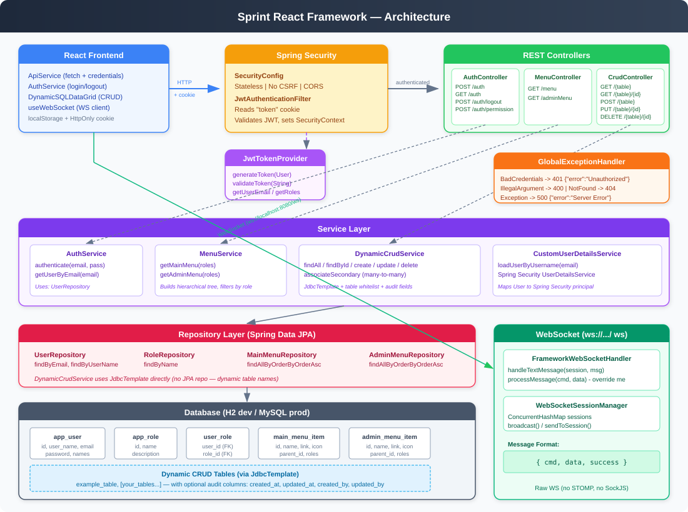

# Spring React Framework — Backend

A reusable Spring Boot backend framework for the React dashboard frontend. Provides JWT authentication, role-based authorization, dynamic CRUD operations, WebSocket support, and automatic audit trails.



## Tech Stack

| Component | Technology |
|-----------|-----------|
| Framework | Spring Boot 3.4.1 |
| Language | Java 17 |
| Security | Spring Security + JWT (jjwt 0.12.6) |
| Database | H2 (dev) / MySQL / PostgreSQL (prod) |
| ORM | Spring Data JPA + Hibernate |
| WebSocket | Spring WebSocket (raw, no STOMP) |
| Build | Maven |

## Quick Start

### Prerequisites
- Java 17+
- Maven 3.8+

### Run (Development)
```bash
mvn spring-boot:run
```
This starts the server on `http://localhost:8080` with an H2 in-memory database.

**Default login:** `admin@localhost` / `admin`

### Run (Production)
```bash
export DB_HOST=localhost
export DB_PORT=3306
export DB_NAME=frameworkdb
export DB_USER=root
export DB_PASSWORD=secret
export JWT_SECRET=<base64-encoded-256-bit-key>

mvn spring-boot:run -Dspring-boot.run.profiles=prod
```

### Connect the React Frontend
```bash
cd ../react_framework
REACT_APP_API_SERVER=http://localhost:8080 npm start
```

## Project Structure

```
src/main/java/com/framework/
  Application.java                     Entry point
  config/
    SecurityConfig.java                Spring Security filter chain (stateless, no CSRF)
    CorsConfig.java                    CORS for cookie-based auth
    JacksonConfig.java                 JSON serialization (UTC, ISO dates)
    WebSocketConfig.java               Raw WebSocket at /ws
  security/
    JwtTokenProvider.java              JWT generation & validation
    JwtAuthenticationFilter.java       Reads JWT from "token" cookie per request
  controller/
    AuthController.java                Login, logout, validate, permissions
    MenuController.java                Role-filtered menu trees
    DynamicCrudController.java         Generic table CRUD
  model/
    User.java                          User entity with role associations
    Role.java                          Role entity
    MenuItem.java                      Abstract menu item (MappedSuperclass)
    MainMenuItem.java / AdminMenuItem.java
  repository/                          Spring Data JPA interfaces
  service/
    AuthService.java                   Authentication logic
    CustomUserDetailsService.java      Spring Security integration
    MenuService.java                   Hierarchical menu builder
    DynamicCrudService.java            Generic CRUD with audit fields
  dto/                                 Request/response objects
  exception/                           Global error handling
  websocket/                           WebSocket handler & session manager
```

## Authentication Flow

```
1. POST /auth  { username: "admin@localhost", password: "admin" }
       |
2. Server validates credentials
       |
3. Server generates JWT (email, roles, userId in claims)
       |
4. Server sets HttpOnly cookie: token=<jwt>
       |
5. Frontend stores user in localStorage, sends cookie on every request
       |
6. JwtAuthenticationFilter reads cookie, validates JWT, sets SecurityContext
       |
7. On expiry: returns { "error": "Expired" } with 401
       Frontend clears localStorage + cookie, redirects to login
```

## API Reference

### Authentication

| Method | Endpoint | Auth | Request | Response |
|--------|----------|------|---------|----------|
| POST | `/auth` | No | `{ "username": "email", "password": "pass" }` | `{ "user": { "first_name", "last_name", "user_name", "email", "roles": [{"name": "Admin"}] } }` + Set-Cookie |
| GET | `/auth` | Yes | — | User object |
| POST | `/auth/logout` | Yes | — | `{ "success": true }` + clear cookie |
| POST | `/auth/permission` | Yes | `{ "nodes": ["Admin"] }` | `{ "Admin": true }` |

### Menus

| Method | Endpoint | Auth | Response |
|--------|----------|------|----------|
| GET | `/menu` | Yes | `[ { "name", "link", "icon", "roles", "items": [] } ]` |
| GET | `/adminMenu` | Yes | Same structure as /menu |

### Dynamic CRUD

| Method | Endpoint | Auth | Description |
|--------|----------|------|-------------|
| GET | `/{table}` | Yes | List all records |
| GET | `/{table}/{id}` | Yes | Get single record |
| POST | `/{table}` | Yes | Create record |
| PUT | `/{table}/{id}` | Yes | Update record |
| DELETE | `/{table}/{id}` | Yes | Delete record |
| GET | `/{table}/{id}/sec/{csv_ids}` | Yes | Update many-to-many associations |

### WebSocket

- **URL:** `ws://localhost:8080/ws`
- **Message format:** `{ "cmd": "string", "data": {}, "success": boolean }`

## Configuration

### application.yml

| Property | Default | Description |
|----------|---------|-------------|
| `server.port` | 8080 | Server port |
| `app.jwt.secret` | (dev key) | Base64-encoded HMAC-SHA256 key |
| `app.jwt.expiration-ms` | 14400000 | Token expiration (4 hours) |
| `app.crud.allowed-tables` | [example_table] | Tables allowed for dynamic CRUD |

### Profiles

| Profile | Database | DDL | SQL Init |
|---------|----------|-----|----------|
| `dev` | H2 in-memory | create-drop | always (data.sql) |
| `prod` | MySQL (env vars) | update | never |

## Adding a New CRUD Table

**1. Create the table** (in `data.sql` for dev, or via migration for prod):
```sql
CREATE TABLE IF NOT EXISTS products (
    id BIGINT AUTO_INCREMENT PRIMARY KEY,
    name VARCHAR(255) NOT NULL,
    price DECIMAL(10,2),
    created_at TIMESTAMP DEFAULT CURRENT_TIMESTAMP,
    updated_at TIMESTAMP DEFAULT CURRENT_TIMESTAMP,
    created_by VARCHAR(255),
    updated_by VARCHAR(255)
);
```

**2. Whitelist it** in `application.yml`:
```yaml
app:
  crud:
    allowed-tables:
      - example_table
      - products
```

**3. Add a menu item** (optional, in `data.sql`):
```sql
INSERT INTO main_menu_item (id, item_order, name, link, icon, parent_id, roles)
VALUES (10, 10, 'Products', '/products', 'Inventory', NULL, NULL);
```

The frontend can now use `<DDataGrid table="products" ... />` with full CRUD support.

## Audit Fields

If a table has any of these columns, they are automatically populated:

| Column | On Create | On Update |
|--------|-----------|-----------|
| `created_at` | Current UTC timestamp | — |
| `updated_at` | Current UTC timestamp | Current UTC timestamp |
| `created_by` | Authenticated user's email | — |
| `updated_by` | Authenticated user's email | Authenticated user's email |

## Security Notes

- JWT stored in **HttpOnly** cookie (not accessible to JavaScript)
- **SameSite=Lax** prevents CSRF on cross-origin POST
- CSRF disabled (stateless API, no server sessions)
- Dynamic table names validated against whitelist + regex
- SQL parameters always use prepared statements
- Passwords hashed with SHA-256 + salt (plain-text fallback in dev only)
- Change `app.jwt.secret` in production
- Restrict `allowedOriginPatterns` in production CORS config

## Database Schema

```
app_user                    app_role
+------------------+        +------------------+
| id (PK)          |        | id (PK)          |
| user_name (UQ)   |        | name (UQ)        |
| first_name       |        | description      |
| last_name        |        +------------------+
| email (UQ)       |
| password         |        user_role (junction)
| password_salt    |        +------------------+
+------------------+        | user_id (FK)     |
                            | role_id (FK)     |
                            +------------------+

main_menu_item / admin_menu_item
+------------------+
| id (PK)          |
| item_order       |
| name             |
| link             |
| icon             |
| parent_id (self) |
| roles            |
+------------------+
```

## H2 Console (Dev Only)

Available at `http://localhost:8080/h2-console`

| Setting | Value |
|---------|-------|
| JDBC URL | `jdbc:h2:mem:frameworkdb` |
| Username | `sa` |
| Password | (empty) |

## Testing

```bash
# Compile
mvn compile

# Run tests
mvn test

# Package
mvn package -DskipTests
```

## License

Internal framework — not for public distribution.
